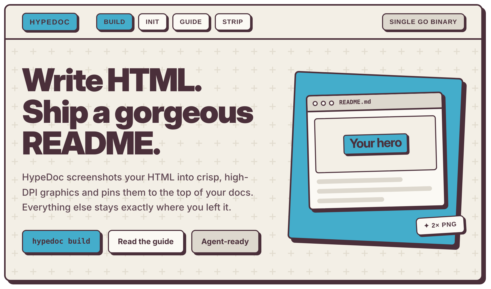
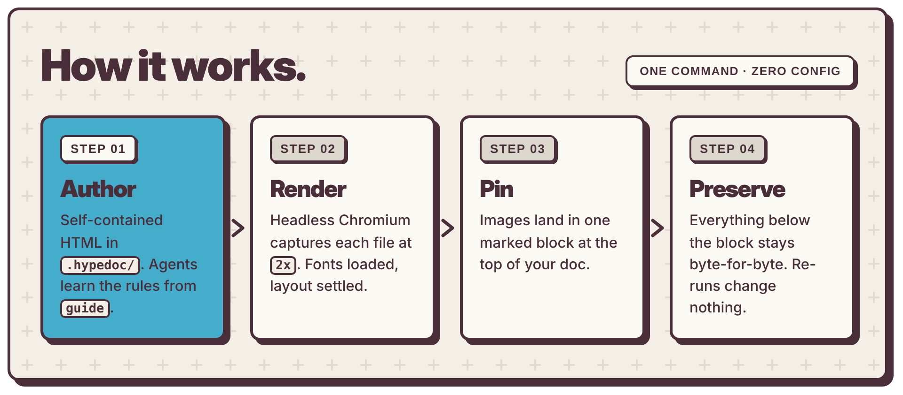
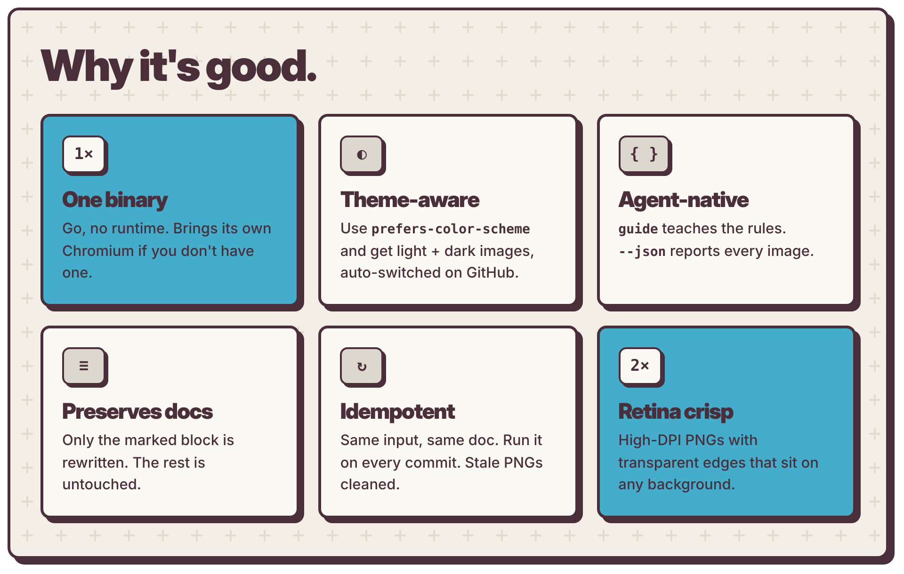
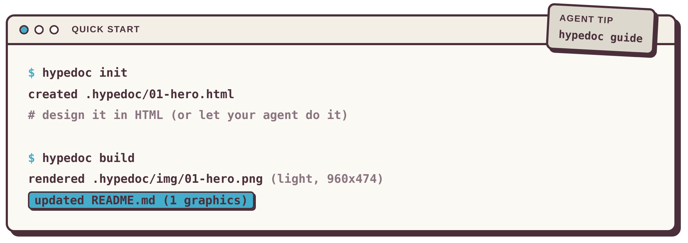

<!-- hypedoc:start -->
<!-- Generated by HypeDoc. Edit the .html sources and run `hypedoc build`; changes inside this block are overwritten. -->
<p align="center">
  
</p>
<p align="center">
  
</p>
<p align="center">
  
</p>
<p align="center">
  
</p>
<!-- hypedoc:end -->

<p align="center">
  <a href="https://go.dev"></a>
  <a href="#agents"></a>
  <a href="#how-the-block-works"></a>
  <a href="LICENSE"></a>
</p>

<p align="center">
  <b>Your README deserves a landing page.</b><br>
  Write HTML. Get crisp, theme-aware graphics at the top of your docs. Touch nothing else.
</p>

<p align="center"><sub>☝️ Every graphic above was made with HypeDoc from <a href=".hypedoc"><code>.hypedoc/</code></a>.</sub></p>

---

## 📦 Install

```sh
curl -fsSL https://raw.githubusercontent.com/stuyk/hypedoc/main/install.sh | sh
```

Linux and macOS, amd64 + arm64. Installs to `~/.local/bin` and verifies the checksum. Pin a version with `HYPEDOC_VERSION=0.1.0`.

Or with Go: `go install github.com/stuyk/hypedoc@latest`. Windows: grab the `.zip` from **Releases**.

> [!TIP]
> No Chrome? No problem. HypeDoc uses your installed Chrome/Chromium, or downloads a pinned Chromium on first run. Override with `--browser` or `HYPEDOC_BROWSER`.

## ⚡ Use it

```sh
hypedoc init     # starter .hypedoc/01-hero.html
hypedoc build    # render → .hypedoc/img/*.png → top of README.md
```

Add more graphics by dropping more `.html` files in `.hypedoc/`. They render in filename order (`01-hero.html`, `02-features.html`, …).

<h2 id="agents">🤖 Hand it to your agent</h2>

Paste this into Claude Code, Cursor, Codex, or whatever you run:

```text
Run `hypedoc guide` and follow it to design graphics for README.md,
then run `hypedoc build --json` and check the images.
```

`guide` teaches the rules (fixed width, inline CSS, light/dark variables, readable sizes). `--json` reports every rendered image back to the agent.

**Using Claude Code?** Copy [`skills/hypedoc/`](skills/hypedoc) into `~/.claude/skills/` and your agent picks up the full workflow on its own.

**Contributing with an agent?** This repo ships [`AGENTS.md`](AGENTS.md) (read by Codex, Cursor, Copilot, and others), [`CLAUDE.md`](CLAUDE.md), and [`llms.txt`](llms.txt).

## 🧱 How the block works

HypeDoc owns exactly one region of your doc:

```html
<!-- hypedoc:start -->
  …generated <picture> tags…
<!-- hypedoc:end -->
```

- **First run:** the block is added at the top (after YAML front matter, if there is any).
- **Every run after:** only the block is replaced. Same input, same output.
- **Theme-aware:** if your HTML uses `prefers-color-scheme`, you get `.light.png` + `.dark.png` and GitHub picks the right one.
- **Undo:** `hypedoc strip` removes it cleanly.

## 🎛️ Reference

| Command | What it does |
|---|---|
| `hypedoc build [flags] [file.html …]` | Render graphics, update the doc |
| `hypedoc init` | Create a starter graphic |
| `hypedoc strip` | Remove the generated block |
| `hypedoc guide` | Print the agent authoring guide |
| `hypedoc version` | Print the version |

<details>
<summary><b>build flags</b></summary>

| Flag | Default | |
|---|---|---|
| `--doc` | `README.md` | Document to update |
| `--src` | `<docdir>/.hypedoc` | HTML source directory |
| `--out` | `<src>/img` | PNG output (stale PNGs cleaned on full builds) |
| `--width` | `960` | Default CSS width |
| `--scale` | `2` | Device pixel ratio |
| `--theme` | `auto` | `auto` · `light` · `dark` · `both` |
| `--opaque` | off | White page background instead of transparent |
| `--browser` | auto | Chrome/Chromium path |
| `--dry-run` | off | Print the doc instead of writing it |
| `--json` | off | Machine-readable report |

</details>

<details>
<summary><b>Per-file meta tags</b></summary>

```html
<meta name="hypedoc:width" content="960">      <!-- CSS viewport width -->
<meta name="hypedoc:selector" content="#card">  <!-- element to capture (default: body) -->
<meta name="hypedoc:alt" content="…">           <!-- alt text (default: <title>) -->
<meta name="hypedoc:wait" content="300">        <!-- extra ms before capture -->
```

</details>

## 🛠️ Develop

```sh
make build     # → bin/hypedoc
make test
make readme    # dogfood: rebuild this README's graphics
```

### Releasing

Bump [`version.txt`](version.txt) and merge to `main`. That's it.

[`release.yml`](.github/workflows/release.yml) checks the version is valid semver and higher than the last release, runs the tests, tags `v<version>`, and publishes binaries for Linux, macOS, and Windows (amd64 + arm64) with checksums via [GoReleaser](https://goreleaser.com). The binary reads its version from the same file, so `hypedoc version` always matches the release.

<p align="center"><sub>MIT · built with HypeDoc, for HypeDoc</sub></p>
